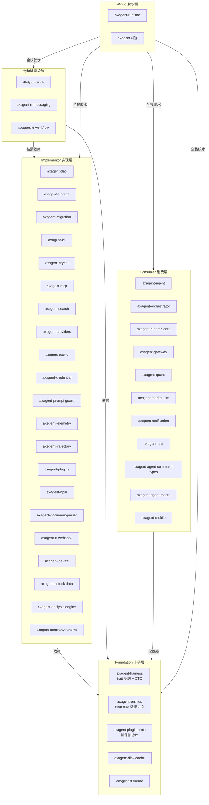

# AxAgent 仓库依赖图与拆分分析

> 状态：active ｜ 日期：2026-10-31 ｜ 对应版本：v3.0.0


> 生成时间：2026‑10‑31  
> 来源：实际代码扫描（`src-tauri/Cargo.toml` workspace 成员 + `src/` 目录结构）

---

## 1. 总体规模

| 区域 | 数量 | 说明 |
|------|------|------|
| Rust crate（`src-tauri/crates/`） | **41** | 另有 `schema-gen` + 根 `axagent` 包，共 **43** 个 workspace 成员 |
| 前端组件目录（`src/components/`） | **40+** | 按业务/功能划分 |
| Store 分类 | 4 层 | `domain` / `feature` / `shared` / `devtools` |
| i18n 语言 | 11 种 | 默认/回退 zh‑CN |

---

## 2. Rust Crate 依赖层级（Mermaid）



---

## 3. 前端组件依赖方向（Mermaid）

```mermaid
graph LR
    subgraph Shared["共享基元"]
        layout["layout"]
        common["common"]
        shared["shared"]
        dynamicUI["dynamicUI"]
        style["style"]
        bits["bits"]
    end

    subgraph Chat["对话域"]
        chat["chat"]
        workflow["workflow"]
        memory["memory"]
        llm-wiki["llm-wiki"]
        wiki["wiki"]
    end

    subgraph Invest["投资域"]
        stock-analysis["stock-analysis"]
        stock-workspace["stock-workspace"]
        quant["quant"]
        invest["invest"]
        recommendation["recommendation"]
    end

    subgraph Agent["智能体域"]
        agent["agent"]
        multi-agent["multi-agent"]
        skill["skill"]
        terminal["terminal"]
        tasks["tasks"]
    end

    subgraph Dev["开发调试域"]
        devtools["devtools"]
        trace["trace"]
        benchmark["benchmark"]
        fine-tune["fine-tune"]
    end

    subgraph Settings["设置/系统域"]
        settings["settings"]
        plugin["plugin"]
        search["search"]
        files["files"]
        voice["voice"]
        help["help"]
        onboarding["onboarding"]
        approval["approval"]
    end

    subgraph Office["办公/OPC 域"]
        office["office"]
        opc["opc"]
        proactive["proactive"]
        time-travel["time-travel"]
        viz["viz"]
    end

    Shared -->|被依赖| Chat
    Shared -->|被依赖| Invest
    Shared -->|被依赖| Agent
    Shared -->|被依赖| Dev
    Shared -->|被依赖| Settings
    Shared -->|被依赖| Office

    Chat -->|依赖| Agent
    Invest -->|依赖| Shared
    Agent -->|依赖| Shared
    Dev -->|依赖| Shared
    Settings -->|依赖| Shared
    Office -->|依赖| Shared
```

---

## 4. 跨层依赖统计

| 方向 | 统计 | 拆分影响 |
|------|------|----------|
| `crates/*` → `harness` | ~30 处直接依赖 | harness 是所有子仓库的公共契约，拆分后须作为独立仓库维护 |
| `crates/*` → `entities` | ~15 处 | entities 与 harness 同为 foundation，拆分后需同步版本 |
| `runtime` → 24+ crates | 根聚合 crate | runtime 是 wiring 层，拆分后作为「组合根」单独维护 |
| `axagent` (根) → 41 crates | 全量依赖 | Tauri 二进制入口，拆分后只依赖各子仓库的发布产物 |
| 前端 → `@/components/*` | 40+ 目录间交叉引用 | 需按业务域拆分时，共享基元（layout/common/shared）需独立成包 |

---

## 5. 拆分可行性判定

| 维度 | 结论 |
|------|------|
| **Rust 侧拆分可行性** | ✅ **高** —— 已有 harness trait 契约 + entities 数据模型，天然支持按 consumer/implementor/hybrid 边界拆分独立 crate 仓库 |
| **前端侧拆分可行性** | ✅ **中高** —— 组件按业务域（chat/invest/agent/dev/office）天然划分，共享基元（layout/common/shared/dynamicUI）可独立成 npm workspace |
| **i18n 拆分** | ⚠ **需整体保留** —— 11 语言 JSON 必须全量同步，不能拆散，但可以作为独立子仓库由专门的翻译团队维护 |
| **Tauri IPC 契约** | ⚠ **需同步版本** —— `build.rs` 生成的命令注册清单是前后端契约，拆分后需通过独立 crate（如 `axagent-contracts`）统一发布 |
| **CI 并行度** | ✅ **高** —— 当前 CI 串行执行 41 crates + 前端，拆分后可按域并行（quant / agent / infra / frontend 各自独立 CI） |
| **本地增量构建** | ⚠ **当前已启用 sccache** —— 但全量 `cargo check` 仍因 workspace 成员多而慢，拆分后各子仓库独立增量可降 60‑80% 等待 |

---

## 6. 建议拆分方案

### 方案 A：按技术层拆（推荐）

> ⚠ **本表已按实测依赖矩阵修正**（见 `dependency-matrix.md`）：补齐原方案漏掉的 5 个 crate，
> 把跨层共享的 `kit` 提升为独立「公共实现层」，并修正 `infra → ai`、`runtime → ai/quant/plugins` 等此前遗漏的层间依赖。

| 子仓库 | 包含 | 说明 |
|--------|------|------|
| `axagent-core` | harness, entities, plugin-proto, disk-cache, rt-theme, agent-command-types, agent-macro | foundation + 契约类型，所有其他仓库的依赖基石 |
| `axagent-infra` | dao, storage, migration, crypto, credential, cache, search, npm, document-parser, rt-webhook, device, telemetry | 基础设施层 |
| `axagent-kit` | kit | **公共实现层**（computer-use）：被 infra/runtime/ai 三方依赖，单独成层以避免跨层边 |
| `axagent-runtime` | runtime, runtime-core, tools, rt-messaging, rt-workflow, crdt, gateway, notification | 运行时 + 混合层（补齐 crdt/gateway/notification） |
| `axagent-ai` | agent, orchestrator, providers, mcp, prompt-guard, trajectory | AI/智能体能力（`kit` 已上提为独立层） |
| `axagent-quant` | quant, market-sim, astock-data, analysis-engine, company-runtime | 量化/投资引擎 |
| `axagent-plugins` | plugins, schema-gen | 插件系统 |
| `axagent-frontend` | src/（React） | 前端应用 |
| **应用壳层**（留主仓库，不拆） | `src-tauri/`（含 269 命令文件的 wiring）+ `crates/axagent-mobile`（staticlib 包壳） | 组合根；mobile 依赖整个 app 是 Tauri 移动端设计使然（见 `dependency-matrix.md` §1） |

**修正后的层间依赖（实测）：**

```
core        → （无出边）
plugins     → core
ai          → core
kit         → core
infra       → core, kit, ai
quant       → core, infra, kit, ai
runtime     → core, infra, kit, ai, quant, plugins
应用壳层     → 全部（组合根；含 mobile staticlib）
```

### 方案 B：按业务域拆

| 子仓库 | 包含 |
|--------|------|
| `axagent-core` | foundation + wiring |
| `axagent-trading` | quant, market-sim, astock-data, analysis-engine, company-runtime |
| `axagent-agent` | agent, orchestrator, providers, tools, kit, mcp, prompt-guard, trajectory |
| `axagent-runtime` | runtime, runtime-core, rt-*, infra crates |
| `axagent-plugins` | plugins, plugin-proto, schema-gen |
| `axagent-frontend` | src/ |
| `axagent-mobile` | mobile |

### 推荐方案 A 的理由

1. **依赖方向清晰** —— 技术层拆分天然符合 AGENTS.md 中的 harness 分层约束
2. **团队职责对齐** —— 每个子仓库对应一个可独立交付的团队
3. **CI 并行度最高** —— 层与层之间只通过 harness 契约交互，CI 可按层并行
4. **演进风险可控** —— 新增业务域（如新的量化模型）只需在 `axagent-quant` 内扩展，不影响其他层

---

## 7. 迁移后目录结构（方案 A）

```
axagent/                         # 主仓库（仅保留根配置 + CI + 公共脚本）
├── .github/workflows/           # CI 编排（按子仓库触发并行作业）
├── scripts/                     # 根级脚本（check-contracts, bump-version 等）
├── docs/                        # 文档
├── axagent-core/                # → git submodule
│   ├── crates/harness/
│   ├── crates/entities/
│   ├── crates/plugin-proto/
│   ├── crates/disk-cache/
│   ├── crates/rt-theme/
│   ├── crates/axagent-agent-command-types/
│   └── crates/axagent-agent-macro/
├── axagent-kit/                 # → git submodule（公共实现层）
│   └── crates/kit/
├── axagent-infra/               # → git submodule
│   ├── crates/dao/
│   ├── crates/storage/
│   └── ...
├── axagent-runtime/             # → git submodule
│   ├── crates/runtime/
│   ├── crates/runtime-core/
│   ├── crates/tools/
│   ├── crates/rt-*/
│   ├── crates/crdt/
│   ├── crates/gateway/
│   └── crates/notification/
├── axagent-ai/                  # → git submodule
│   ├── crates/agent/
│   ├── crates/providers/
│   └── ...
├── axagent-quant/               # → git submodule
│   ├── crates/quant/
│   ├── crates/market-sim/
│   └── ...
├── axagent-plugins/             # → git submodule
│   ├── crates/plugins/
│   └── schema-gen/
├── axagent-frontend/            # → git submodule (npm workspace)
│   ├── src/
│   ├── package.json
│   └── vite.config.ts
└── src-tauri/                   # 应用壳层（留主仓库，不拆）
    ├── src/                     # 269 个命令文件的 wiring 层
    └── crates/axagent-mobile/   # staticlib 包壳，随壳层保留
```

---

## 8. 关键约束与风险

| 风险 | 缓解措施 |
|------|----------|
| harness 版本不同步导致编译断裂 | harness 作为独立仓库，采用 semver + CI 自动发布到内部 registry |
| 前端 `@/` 别名在子仓库失效 | 子仓库内重新配置 `vite.config.ts` 的 resolve.alias |
| Tauri 命令注册跨仓库 | `build.rs` 改为扫描各子仓库的 `register_commands.rs` 产物 |
| i18n 11 语言同步 | i18n 独立子仓库，前端通过 npm workspace 引用 |
| CI 缓存策略复杂 | 每个子仓库独立 CI 作业，使用各自的 cache key |
| 本地开发体验 | 提供 `scripts/dev.sh` 统一入口，内部跳转到各子仓库执行 |

---

## 9. 结论

当前仓库规模（41 Rust crates + 40+ 前端组件目录）已经达到 monorepo 的效率拐点。通过按**技术层**拆分为 8 个逻辑子仓库（`core` / `kit` / `infra` / `ai` / `quant` / `plugins` / `runtime` / `frontend`）+ 保留在主仓库的**应用壳层**（`src-tauri` + `axagent-mobile`），配合独立 CI 流水线，预计可：

- **构建时间**：从 ~20 min 降至 **≤5 min**（并行 + 增量）
- **并行开发**：多个团队在各自子仓库独立 PR，互不阻塞
- **故障隔离**：回归测试范围缩小，定位缺陷更快
- **代码所有权**：子仓库负责人清晰，新人 onboarding 成本降低
