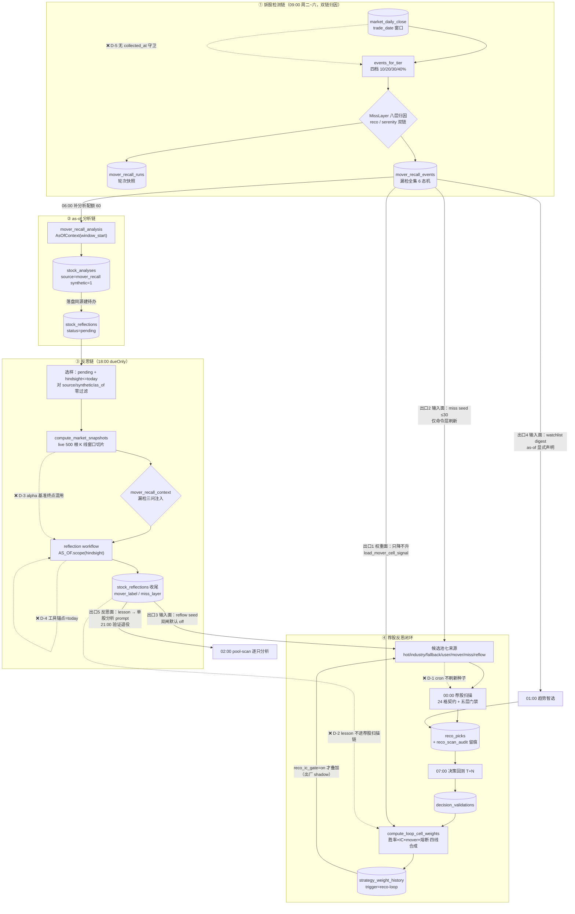

# AUDIT：妖股漏检后的 as-of 分析—反思—荐股反思闭环

> 状态：active ｜ 日期：2026-10-23 ｜ 对应版本：v2.9.9


- 日期：2026-10-23
- 范围：`src-tauri/` 股票业务域（`crates/analysis-engine`、`crates/harness`、`crates/dao`、`crates/astock-data`、`src/commands/stock_workflow`、`src/init`）
- 方法：全链路源码核对（关键结论均经二次人工复核），不动代码、不跑门禁
- 术语边界：**妖股 = 窗口累计涨幅达标**（判据唯一来源 `mover_gain_*` 四档阈值 × `Period::default_holding_days()` 窗口）；**漏检 = `MissLayer` 归因层名目**；智能荐股与趋势智选是**两条链**（`RecoChain::Reco` / `RecoChain::Serenity`），仅在 `reco_picks` 同表共存

---

## 一、结论摘要

闭环**四段链路代码全通、且有 13 条内置定时任务驱动**，妖股漏检共有 **5 个出口**（权重面 1 / 输入面 3 / 反思面 1）。但复核发现 **7 处缺陷**，其中 2 个 P0：

| # | 缺陷 | 层级 | 一句话 |
|---|---|---|---|
| D-1 | cron 荐股路径不刷新漏检/回灌/涨幅榜种子 | 荐股链 | 00:00 自动荐股（落库主生产者）的候选池**永远看不到最新漏检票**；而 09:00 核查评的正是这轮出票 ⇒「池子没看见」在自动链里无法自愈 |
| D-2 | lesson 不反哺荐股扫描链 | 反思链 | 「漏检→反思→教训→荐股策略改进」的最后一段**在代码上不存在**（`recommender/` 对 lesson grep 零命中） |
| D-3 | 反思 alpha 口径两端点混用 | as-of | 个股 entry→entry+N vs 基准 entry→**live 最新** |
| D-4 | 漏检反思工具锚点 = 执行日，前视张力 | as-of | 三问①要求「只列窗口起点当时可见信号」，但 LLM 工具以 today 为 AS_OF 锚点 |
| D-5 | `market_daily_close` 无 `collected_at` 守卫 | as-of | 回放/核查可能把「业务日 ≤ as-of 但采集日晚于 as-of」的晚到行算进窗口涨幅 |
| D-6 | `mover_label` / `miss_layer` 消费面不到出票逻辑 | 归因层 | 只达进化分桶 + 面板 + 反思 prompt |
| D-7 | `scored_out=0 ⇒ mover 线不动` + 历史无留痕 | 权重面 | 2026-09-13 前 cron 不写 `reco_scan_audit` ⇒ 早期格子漏检线长期无电 |

---

## 二、链路全貌

### 2.1 内置定时任务时刻表（现网 13 条，`src/init/stock_automation_cron_seed.rs`）

| 时刻 | 任务 | task_type | 与闭环的关系 |
|---|---|---|---|
| 00:00 | 智能荐股（四档） | `stock-recommendation` | 出票 → `reco_picks`（实盘代） |
| 01:00 | 趋势智选（serenity 工作流） | `trend-screening` | 出票 → `reco_picks style='serenity'` |
| 02:00 | 候选池逐只深度分析 | `pool-scan` | 消费 00:00/01:00 产物（`Synthetic=0` + `AsOfDate IS NULL`） |
| 04:00 | 中断分析补跑（as-of 补历史） | `stock-analysis-rerun` | 不进交易日闸门 |
| 05:00 | 编码段盲扫（只登记清单） | `universe-scan` | 抬 `market_stock_universe` 覆盖率 |
| 06:00 | **漏检补分析** | `mover-recall-analysis` | 消费 pending 事件 → as-of 重放 → 建反思待办 |
| 07:00 | 决策回测（T+N 验证） | `decision-backtest` | → `decision_validations` → **链式重算闭环权重** |
| 07:30 | 交易意图过期 | `intent-expiry` | — |
| 09:00（周二~六） | **妖股漏检核查**（双链归因） | `mover-recall` | 不走交易日闸门；评的是当日已出票 |
| 16:00 | 组合指标日更 | `portfolio-metrics` | 进交易日闸门 |
| 18:00 | 到期反思（dueOnly） | `batch-reflection` | 消费全部 pending 反思行（含补分析行） |
| 20:00（工作日） | 进化计划聚合 | `evolution-proposal` | 吃当天反思/验证/漏检样本，不自动执行 |
| 21:00（工作日） | 教训验证与退役 | `lesson-validation` | 调 `reflection_lessons.confidence` / 退役 |

### 2.2 四段链路

**① 妖股检测链**（`crates/analysis-engine/src/mover_recall.rs` + `src/commands/mover_recall.rs`）

```
market_daily_close（trade_date 窗口，复利连乘 cum_gain）
  → events_for_tier（四档 10/20/30/40%，窗口 2/5/28/90 交易日）
  → build_chain_view（reco / serenity 各一份）
  → MissLayer 八层归因（attribute 纯函数，优先级机械）
  → mover_recall_runs（轮次快照）+ mover_recall_events（漏检全集，状态机 6 态）
  → rates：reachability / coverage / unexplained_share（分母 0 ⇒ NaN ⇒ 面板「样本不足」，不显示 0%）
```

八层归因（`mover_recall.rs:251`）：`Recommended` / `PriorCovered` / `NotInPool` / `PoolDegraded` / `ByDesign` / `L3ScoredOut` / `OtherPeriod` / `Unexplained`；计入漏检分母的是后五层中的 `NotInPool | PoolDegraded | L3ScoredOut | OtherPeriod | Unexplained`（`counts_as_miss`，:305）。

**② as-of 分析链**

- 契约层：`crates/harness/src/as_of.rs` —— `AsOfContext{as_of_date, source, data_scope}`，FutureDate 校验、`AsOfDataScope::All|Structured`（混合模式：结构化数据 as-of 截止，新闻/公告/研报保持实时）、`DegradationEntry` 三档（`Failure`/`NoData`/`StructuralGap`）× mode（`asOf`/`live`）。
- 运行时：`astock-data::as_of::AS_OF` task_local 封闭世界栈（`with_optional_asof` / `AS_OF.scope`）。
- 漏检补分析（`src/commands/mover_recall_analysis.rs:599-661`）：按 `window_start` 分组、逐日 `AsOfContext::new(date, ScheduledReplay)` 重放；产出 `stock_analyses`（`source='mover_recall'`、`synthetic=1`、`anchor_event_id`、`as_of_date=window_start`），**按设计不写 `reco_picks`** ⇒ 决策回测真实命中率分母天然不含补分析行（妖-7 已裁定）。
- 补分析落盘时同源建反思待办（`src/commands/stock_workflow/core.rs:2382-2415`）：`stock_reflections` pending 行，`source` 建点盖章、`as_of_date=window_start`、`hindsight_date` = 锚点 + N+1 交易日外推（恒为过去日）。

**③ 反思链**（`src/commands/stock_workflow/reflection.rs`）

- 选样（:2798-2828）：`status='pending'` + dueOnly 时 `HindsightDate <= today`（SQL 下推）+ horizon 同档或 NULL + 可选 `analysis_ids`。**对 `source`/`synthetic`/`as_of_date` 零过滤** ⇒ 补分析行在队列内且到期判据恒满足。
- 执行：`compute_market_snapshots`（live 拉 500 根 K 线，窗口切片 entry→entry+N）→ `mover_recall_context` 漏检专项三问（注入条件：被复盘分析行 `source='mover_recall'` + `anchor_event_id` 非空 + 事件存在；缺一 ⇒ 占位句）→ workflow 执行（`AS_OF.scope(hindsight_ctx)`）→ 收尾 UPDATE。
- 产物列：`verdict` / `lesson_summary` / `what_went_wrong` / `missed_signals` / `fix_for_future` / `parameter_suggestions_json` / `mover_label`（四态）/ `miss_layer` / `pool_reflow` / `strategy_performance` M1 样本。
- 硬裁决：`reflection_validator.rhai`（R-302 verdict 缺省 partial / R-303 截断 / R-304~R-306 类型规范化），`continue_on_fail: true` 不阻塞落盘。

**④ 荐股反思闭环**（`crates/analysis-engine/src/recommender/reco_loop.rs`）

```
00:00 荐股扫描 → reco_picks（+ reco_scan_audit L3 截断留痕 + reco_pool_batches 池快照）
  → 07:00 决策回测（T+N，decision_date_of 回放用 as_of_date）
  → decision_validations（hit/miss/false_hit/partial/insufficient，按 (pick_id,t_plus_n) 幂等）
  → maybe_recalc_reco_loop（services.rs:3248，链式触发）
  → compute_loop_cell_weights 四线合成：
        胜率线（weight_decay EWMA，Beta 平滑）
      × IC 线（rank IC < 0 ⇒ ×NEGATIVE_IC_PENALTY=0.5）
      × mover 漏检线（Laplace (hits+1)/(hits+scored_out+1)，门槛 MOVER_MIN_EVIDENCE=3，只降不升）
      × 熔断线（DQI (clear+1)/(clear+fused+1)，门槛 3）
      → ratchet_weight 棘轮（new ≤ old，任何分支）
  → strategy_weight_history（trigger='reco-loop'）
  → load_reco_served_vars_db（reco_ic_gate=on 才叠加；出厂 shadow）
  → 下次扫描消费
```

---

## 三、妖股漏检的五个出口（逐条证据）

### 出口 1｜权重面：`MoverCellSignal` 逐格降权（只降不升）

- 装配：`mover_recall.rs:623-719` `load_mover_cell_signal(db, vars, as_of_date)`。`scored_out` 来自 `reco_scan_audit`（算出了却排在组内 top-N 外），`hits` 来自 `reco_picks`（`synthetic==0` 且 `generated_at ∈ [window_start, anchor_date]`）。
- **只吃荐股链**（:660-661）：`picks.filter(|p| RecoChain::of_style(&p.style) == RecoChain::Reco)` —— A-2 裁定，防智选出票抬高荐股格分子。
- 合成（`reco_loop.rs:554-695`）：`outer_penalty = mover_penalty × dqi_penalty`；IC 未校准 ⇒ `keep_prior_weight`（保留当前权重，只允许外乘线继续降）；最后统一过 `ratchet_weight`。
- 触发三处：07:00 决策回测后链式（`maybe_recalc_reco_loop`，as_of=None）、手动 `recalc_reco_loop_weights(as_of_date)`（A/B 回放，:5276）、面板 `reco_loop_view`（只读）。
- **局限**：`scored_out == 0` ⇒ `None` 不动权重（:447「无留痕 ≠ 没淘汰」）；`PLAN-mover-recall-attribution.md` §Phase 4 明文**禁止用 mover 数据提权** ⇒ 漏检的语义「下次要选到它」与唯一自动动作「降权」方向相反（PLAN F-8 已登记）。

### 出口 2｜输入面：漏检直供候选池（miss seed）

- 取数：`dao/mover_recall_events.rs:186` `latest_reco_miss_codes` —— 只取**最新一轮 `chain='reco'`** 的 `not_in_pool` / `unexplained` 层，按涨幅降序去重；不取 `l3_scored_out`（评分算过并主动淘汰，回灌会与评分口径打架）。
- 注入：`stock_analysis.rs:4936-4954` `refresh_miss_seed`（上限 30）→ `set_miss_seed`（进程内 `RwLock`，覆盖语义）→ `recommender/mod.rs:884-895` `merge_extra_seed` 并入两级池（`seed` 过流动性门 + `raw_seed` 不过门）。
- ⚠ **只在命令层 `recommend_stocks_all_periods:5078-5091` 刷新**；cron 路径不刷新 —— 见 D-1。

### 出口 3｜输入面：反思回灌清单（reflow seed，默认 shadow）

- 反思结构化结论 `pool_reflow{should_include, reason}`（`reflection.md:286` + rhai 归一化）→ `pool_reflow_of`（reflection.rs:127-135）→ `mark_reflow_pending`（dao:164-179，**只从 `analyzed`/`reflected` 盖章**）→ `list_reflow_candidates`。
- 转正双闸（`stock_analysis.rs:4956-5014` `refresh_reflow_seed`）：① `settings.mover_reflow_merge="on"`（默认 off）；② `settled >= REFLOW_MIN_SETTLED=30`（fail-closed：样本不足是**拒绝**不是放行）。
- 同样只在命令层刷新 —— 见 D-1。

### 出口 4｜输入面：智选达标清单（watchlist digest）

- `mover_recall.rs:992-1017` `mover_watchlist_digest` → `serenity.rs:1044-1082` 作为 `a-trend-scanner` 第 4 个输入（`mover_watchlist`，limit 20）。
- **as-of 前视防护**（:956-958）：`MOVER_WATCHLIST_ASOF_DECLARATION`「本代无达标清单（as-of 回放不取 live 的窗口涨幅清单，避免前视）」；serenity.rs:1047-1050 对应分支：`as_of_ctx.is_some() ⇒ 声明，否则 digest`。取数失败也注入声明，**不静默成空串**。
- 定性（mover_recall.rs:962-963）：「输入面素材，不构成入选理由，证据门槛不因此下降」。

### 出口 5｜反思面：补分析 → 反思 → lesson / 进化

- 06:00 补分析（cron 配额 60）→ `stock_analyses(source='mover_recall', synthetic=1)` + `stock_reflections` pending（source 同源盖章）。
- 18:00 到期反思消费（选样对 source 零过滤）→ 漏检三问 → `lesson_summary` → `extract_lesson_to_rule`（reflection.rs:1781-1899）→ `reflection_lessons`（去重键 `(stock_code, lesson_summary, horizon)`；入模校验 `validate_lesson_for_admission`：长度 10–200 / 行动词命中 / 空洞短语拒绝；初始置信度 wrong 0.7 / partial 0.5 / 其他 0.3）。
- lesson 注入单股分析 prompt：`hooks.rs:966-983` `fetch_stock_lessons`（`confidence>=0.3`、同档、`template_version>=125`）→ `stock_lessons` 变量 → `trader.md:17` / `research-manager.md:15` / `reflection.md:19`；引用追踪 `lesson_applications` → T+N 回测回写 outcome → 21:00 `run_lesson_validation` 调 confidence / 强废弃（≥5 次应用且成功率 <0.3 ⇒ 0.1 + deprecated）。
- 进化侧：反思 `parameter_suggestions_json`（手动 `apply_param_suggestions` 写 `workflow_template.variables`）、`strategy_performance` M1 样本 → `evolution_optimizer`（只调 `WeightDecayConfig` 三参数，喂**分析链**）、20:00 `evolution_proposal` 聚合三类样本（reflections / validations / mover misses，`reflection_label ∈ {no_market_data, rule_unavailable}` 不驱动进化）。
- ⚠ lesson 闭环**终止于提示词层**，不进荐股扫描链 —— 见 D-2。

---

## 四、as-of 一致性专项

| 检查点 | 事实 | 判定 |
|---|---|---|
| 补分析锚点 | `AsOfContext::new(window_start, ScheduledReplay)`，`as_of::with_optional_asof` 封闭世界栈 | ✅ 干净 |
| 荐股 P1 回环否决守卫 | `gates` 回放时 `veto_var=None`（`recommender/mod.rs:1333`：`as_of::current_as_of().is_none()` 才取 `reco_analysis_vetoes`） | ✅ 不带今天的否决 |
| 智选 watchlist | as-of 注入显式声明，不开 Fallthrough | ✅ |
| 决策回测窗口 | `fetch_window_series` 从决策日**之后**第一根 K 线起取 n 根（backtest_validation.rs:394） | ✅ |
| 代际筛样 | 读侧全部门（回测 `screen_by_reco_generation` / IC `aggregate_reco_ic` / 历史列表 / 池选择 / 收盘归档）显式 `as_of_date IS NULL` 或下限筛，`scripts/check-reco-generation.mjs` 拦漏加 | ✅ |
| 反思 alpha | 个股 entry→entry+N vs **基准 entry→live 最新**（reflection.rs:3353-3361） | ❌ D-3 |
| 反思工具锚点 | `hindsight_date` 实参 = `today_str`（reflection.rs:2686 → :827） | ❌ D-4 |
| 窗口涨幅取数 | `load_closes_by_stock` 只按 `trade_date` 过滤，无 `collected_at` 守卫；表允许 `kline_backfill` 事后回填历史交易日 | ❌ D-5 |
| 核查主入口 | `analyze_mover_recall_inner(db, to)` 无 `AsOfContext` 参数，picks/留痕固定传 `None`（实盘代） | ⚠ 设计如此（面板只读核查不落库），但代际谓词已现成（mover_recall.rs:843/905）未暴露 |

---

## 五、缺陷清单（本轮新查出）

### D-1（P0）cron 荐股路径不刷新漏检/回灌/涨幅榜/用户种子

| 项 | 内容 |
|---|---|
| 事实 | `src/init/services.rs:2465` cron 分支直接 `run_recommendation_scan(client, &config.periods, &vars, ...)`；`refresh_user_seed` / `refresh_mover_seed` / `refresh_reflow_seed` / `refresh_miss_seed` 四个刷新点全部只在命令层 `recommend_stocks_all_periods`（`src/commands/stock_analysis.rs:5078-5091`）。种子是进程内 `RwLock` 覆盖语义（`recommender/mod.rs:180-214`）⇒ cron 用的是上次手动刷新残留（stale）或空 |
| 后果 | 00:00 自动荐股是 `reco_picks` **落库主生产者**，其候选池恒为 hot50 ∪ industry30 ∪ FALLBACK；漏检直供（≤30 只）在自动链里**从不刷新**。而 09:00 核查评的正是 00:00 这轮出票 ⇒ 归因出的「池子没看见」（现网 reco 链 not_in_pool 38/65）在自动链里永远无法自愈，只能等用户手动点刷新 |
| 关联 | `PLAN-reco-reflection-closure.md` D2 只修了「变量口径统一」（cron 改走 `load_reco_served_vars_db`，services.rs:2440 ✅），**没修种子注入分裂**；`PLAN-missed-mover-reflection-closure.md` F-1~F-13 均未登记此形态 |
| 修法方向 | cron 分支扫描前补四个刷新调用（与命令层同序）；或把种子刷新下沉进 `run_recommendation_scan` 前置。注意种子是进程内状态，cron 与命令层同进程 ⇒ 刷新即可生效，无需改存储 |

### D-2（P0，产品语义）lesson 不反哺荐股扫描链

| 项 | 内容 |
|---|---|
| 事实 | `reflection_lessons` 全生命周期代码完整（建行 → prompt 注入 → `lesson_applications` 引用追踪 → T+N 回写 → 21:00 验证退役），但 `grep -i lesson crates/analysis-engine/src/recommender/` **排除注释后零代码命中**：候选池门禁（`gates.rs` 只有 P0 财报预检 + P1 分析回环否决）、评分权重（`scoring.rs` 出厂常量，自适应机制已删）、`reco_loop` 四线合成（样本源 `decision_validations`，无 lesson 入参）、进化参数（`evolution_optimizer` 只读 `strategy_performance`）**没有一个消费 lesson** |
| 后果 | 「妖股漏检 → 反思 → 教训 → 荐股策略改进」的最后一段在代码上不存在。lesson 影响的只是**出票后逐只分析**（pool-scan）的 LLM prompt |
| 辨析 | 这与 `PLAN-reco-reflection-closure.md` 的设计意图**一致**（该文 §0：「荐股链是纯规则打分，反思对它的优化形态不是改 prompt，而是把荐股自己的实现结果回写成置信权重」）——即「lesson→荐股」本就是设计上不走的一条；但用户视角的「反思闭环」通常预期教训能改变选股行为。**属产品语义决策，不擅改，单列告知** |
| 若要求闭合 | 可选形态：① lesson 的 `fix_for_future` 参数建议进 `apply_param_suggestions` 同一条写 `workflow_template.variables` 的路（已有手动通道，缺自动接线）；② 新增「lesson 线」进 `compute_loop_cell_weights`（须先拍板方向：只降不升惯例下，教训只能压制相关格）；③ 维持现状，在面板上把「lesson 作用于分析链 prompt、不出票逻辑」如实成句 |

### D-3（P1）反思 alpha 口径两端点混用

- 事实：`reflection.rs:3353-3361` `compute_benchmark_change(client, &entry_bar.date, &latest_bar_all.date)`，`latest_bar_all = klines.last()`（执行时最新一根）；而个股收益是 `entry → entry+N`（`horizon_window`，:3229-3233）。
- 后果：补分析行锚点久远 ⇒ `alpha_pct = 个股历史窗口收益 − 基准 entry→今天收益`，两端点不同日。该值落 `stock_reflections.alpha_return` / `alpha_cited`，进面板与 20:00 进化聚合样本。
- 修法方向：基准同取 `entry → entry+N` 窗口终点（ comparator 已有 horizon 终点，取其日期即可）。

### D-4（P1）漏检反思工具锚点 = 执行日，前视张力

- 事实：`reflection.rs:2686` 传 `&today_str` 作 `hindsight_date` → :827 `AsOfContext::parse(hindsight_date)` → :831-833 `AS_OF.scope(...)` 包装 workflow 执行。注释（:821-826）明示「工具调用走 AS_OF(hindsight_date)」，而此处 hindsight 即 today。
- 后果：漏检专项三问①要求「只允许列窗口起点 {start} 当时系统**已经可见**的具体信号」（reflection.rs:162-175），但 LLM 的 K 线/公告工具以**执行日**为锚 ⇒ 模型可调工具拿到窗口内实际走势，再倒编「当时可见」。约束仅靠 prompt；`reflection_validator.rhai` 不校验信号可见性。
- 辨析：对**常规到期反思**这是刻意设计（复盘就是要看实际走势）；缝隙只在漏检专项的「当时可见」语义上。
- 修法方向：漏检专项行把 hindsight 锚点改为**窗口终点日**（`hindsight_date` 列已有该值，建点时按锚点+ N+1 外推），或在该分支的工具权限上限制 K 线回溯范围；至少面板对「漏检反思的信号可见性未经机器校验」如实成句。

### D-5（P1）`market_daily_close` 无 `collected_at` 守卫

- 事实：`mover_recall.rs:566-572` `load_closes_by_stock` 只按 `TradeDate.gte(from).lte(to)` 过滤；该表允许事后回填历史交易日（`ensure_close_history` → `backfill_close_history_for_codes` 补 90 天逐票日线，`source='kline_backfill'`；实体注释 `entities/market_daily_close.rs:40`）。`load_close_dates`（:746）同样无守卫。
- 后果：`trade_date <= as_of` 但 `collected_at > as_of` 的晚到行会进入窗口涨幅计算 ⇒ 达标/漏检判定可能依赖回放当时**不可得**的数据。`collected_at` 列本就存在（实体注释：「区分『哪天采的』与『哪天的数据』」）却无任何读取方按它截断。
- 不影响：补分析批次侧走 `as_of::with_optional_asof` 封闭世界栈，无此问题。
- 修法方向：as-of 语义的读取路径（核查入口一旦开放 as-of 参数、`load_mover_cell_signal` 的 A/B 回放）加 `collected_at <= as_of` 守卫；注意这会改变现网分子分母，须与 D-1 同批评估。

### D-6（P2）`mover_label` / `miss_layer` 消费面不到出票逻辑

- 事实：`mover_label`（四态 mover/normal/window_incomplete/no_market_data）全仓读者只有 20:00 进化分桶（`evolution_proposal.rs:150-158`，两态不驱动进化）+ 前端投影/表格；`miss_layer` 读者只有漏检反思 prompt + 面板 + `stamp_reflected`。
- 后果：「这条漏检卡在哪一层」到不了荐股门禁/评分 ⇒ 例如 `L3ScoredOut`（评分算过但被 top-N 淘汰）与 `NotInPool`（池子没看见）的优化动作完全不同（前者调评分、后者扩池），但出票逻辑对两者无感知。
- 修法方向：至少把归因层纳入 `reco_loop` 的格信号键（现键是 `(style, period)`，可扩为 `(style, period, layer)`），或面板明示「归因层不影响出票」。

### D-7（P2）`scored_out=0 ⇒ mover 线不动` + 历史无留痕

- 事实：`reco_loop.rs:447` `scored_out == 0 || scored_out + hits < MOVER_MIN_EVIDENCE(3) ⇒ None`（设计：「无留痕 ≠ 没淘汰」）；`reco_scan_audit` 只有荐股链写，且 cron 路径 2026-09-13 才开始写（services.rs:2506-2513 注释自陈「此前定时链从不写这张表 ⇒ 漏检核查读到的窗口大面积为空 ⇒ 归因整批落 Unexplained」）。
- 后果：2026-09-13 前的格子无留痕 ⇒ mover 线对新风格/新格子长期无电；智选链 `l3_scored_out` 按设计永不可判（B-2 已证伪退役：智选候选全部写入 `reco_picks`，内存里不存在「被淘汰」候选）。
- 判定：设计使然（非缺陷），但**效果**是漏检线对大部分格子长期不动 —— 面板应把「该格无留痕 ⇒ 漏检线未参与」与「校准过且良好」分开成句（Phase D 三态已在 IC 面板落地，mover 列同款待确认）。

---

## 六、引用 `PLAN-missed-mover-reflection-closure.md` 已登记、执行状态未见收口的项

| 项 | 状态 | 备注 |
|---|---|---|
| F-4 分母 11.5%（universe 681/5924） | C-1 已落地（编码段盲扫只登记），覆盖率随积累 | 漏检域 ≠ 全市场，面板已如实呈现 |
| F-12 lesson 档位隔离（`horizon = h OR NULL` 跨档漏入，`stock_lesson_queries.rs:218`） | **执行状态无收口记录**；现网读数仍为 OR NULL 形态 | 妖股漏检教训多为超短语境，漏进中线分析是已知危害 |
| B-3 智选后验独立进权重闭环 | 未落地，且原推荐**构造性无效**（`bottleneck_composite` 三力同乘不改 argmax）；真正杠杆是入选阈值/逐档配额，待拍板 | 现网智选 live 仅 6 行 `reco_picks`，样本不足 |
| 妖-7 补分析样本不进荐股胜率分母 | 已裁定「不进」 | 保持「补分析为反思供样，不是为荐股出票」 |

---

## 七、流程图

### 7.1 总闭环（Mermaid）



### 7.2 断点地图（文字版）

```
漏检事件（mover_recall_events）
 ├─ 出口1 → MoverCellSignal → reco_loop 四线合成 → 棘轮只降不升
 │           ⚠ scored_out=0 不动（D-7）；serenity 链不接（B-2 已证伪）
 ├─ 出口2 → latest_reco_miss_codes → set_miss_seed → merge_extra_seed
 │           ⚠ 仅命令层 recommend_stocks_all_periods 刷新（D-1）
 ├─ 出口3 → pool_reflow → reflow_pending → refresh_reflow_seed
 │           ⚠ 双闸：mover_reflow_merge=on（默认 off）+ settled≥30（fail-closed）；同样仅命令层（D-1）
 ├─ 出口4 → mover_watchlist_digest → serenity a-trend-scanner
 │           ✅ as-of 显式声明；仅输入面不提权
 └─ 出口5 → 06:00 补分析（as-of window_start）→ stock_analyses → 18:00 反思
             ├─ lesson_summary → reflection_lessons → 单股分析 prompt → 21:00 验证
             │      ⚠ 终止于 prompt，不进荐股门禁/评分/闭环/进化（D-2）
             ├─ parameter_suggestions → 手动 apply_param_suggestions → workflow_template.variables
             │      ⚠ 手动通道，无自动接线
             └─ strategy_performance M1 → evolution_optimizer（WeightDecayConfig 三参数）
                    ⚠ 只喂分析链，不直接改荐股扫描参数
```

---

## 八、修复优先级建议（不擅改，待授权）

| 优先级 | 项 | 理由 |
|---|---|---|
| P0 | D-1 cron 种子刷新 | 纯缺陷修复（与 D2 变量统一同族），改动面小（services.rs 一处分支 + 四个已有函数）；不修则「池子没看见」归因（现网 reco 链 38/65）在自动链里永续 |
| P0 | D-2 产品语义裁决 | 需用户拍板：lesson 是否应影响出票逻辑（三条形态见 D-2 表）；不裁决则「反思闭环」的预期差长期存在 |
| P1 | D-3 alpha 基准终点对齐 | 一行比较对象的修改，但影响已落库 `alpha_return` 的历史可比性 ⇒ 需与 D-5 同批评估 |
| P1 | D-4 漏检反思工具锚点 | 把漏检专项分支的 hindsight 锚点从 today 改为窗口终点；注意常规反思保持 today（刻意设计） |
| P1 | D-5 `collected_at` 守卫 | as-of 读取路径加采集时刻截断；会改变现网分子分母 ⇒ 与 D-1 同批 |
| P2 | D-6 / D-7 归因层消费与呈现 | 归因层纳入格信号键 / 面板三态成句 |

> 报告纪律：本文只登记事实与断点，**未改任何代码**；所有「修法方向」待用户授权后另起批次。相关既有文档：`PLAN-missed-mover-reflection-closure.md`（A/B/C/D 阶段收口状态）、`PLAN-reco-reflection-closure.md`（荐股闭环设计）、`PLAN-mover-recall-attribution.md`（归因口径）。
