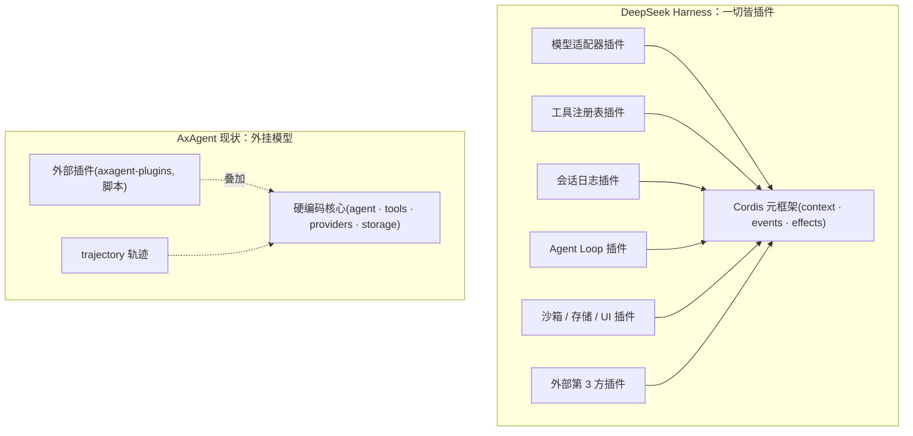

> 来源：导入自上游 AxAgent（基准 99c9b96f，2026-09-07） ｜ 导入日期：2026-11-04

# 「一切皆插件」的 Agent 架构范式：DeepSeek Harness 解读与 AxAgent 重构路径

> 研究报告 · 2026-08-14 · 面向 AxAgent 技术决策

## 摘要

DeepSeek Harness 将「**Everything is a Plugin**（一切皆插件）」作为核心哲学：模型、工具、技能、会话、沙箱、存储、循环、UI，所有 Agent 能力都由挂在 Cordis 元框架上的插件组合而成，**系统里没有需要 patch 的特权核心**[2]。

本报告的核心判断是：**「插件化 / 可组合化」是 Agent 框架的确定性方向**，这已被 2024–2026 年的行业演进（MCP→Agent Skills→Agent Plugins 标准）反复验证[8][6]；但「一切皆插件」——把*内置核心*本身也插件化——是这条路径的**范式顶点**，而非所有项目的普适起点，需要依据自身约束按需采纳。

> **对 AxAgent 的结论**
>
> AxAgent 已具备**约七成**的架构基础（harness 契约层、external 插件系统、trajectory 会话日志、providers 抽象），重构的本质不是推倒重来，而是把「内置核心」从硬编码的 crate 依赖升级为**与外部插件平权的一等公民**，并补齐可逆效果、类型化事件、会话日志不变量三块拼图。

## 1. DeepSeek Harness「一切皆插件」拆解

### 1.1 定位：不是新模型，是 Agent 运行框架

DeepSeek Harness（CLI 工具名 `dsh`）是 Agent 运行框架，核心公式是 `Model + Harness = Agent`：大模型负责思考推理，Harness 负责工具调度、任务管理、执行闭环、轨迹记录等「工程化」环节，直接对标 OpenAI Codex、Anthropic Claude Code[2]。它把 DeepSeek 的竞争力从模型层延伸到「让 AI 真正把活干完」的执行层[3]。

### 1.2 底层：Cordis 元框架与五大概念

Harness 不自造插件轮子，而是跑在 Cordis 插件系统上——一个「元框架」，只负责插件的加载、卸载与依赖关系，不掺和具体业务[2]。Cordis 的设计源自北大与 DeepSeek 联合的「时空可组合性编程范式」论文，用五个概念保证「每个模块都可能被替换时仍能正确协作」[2][10]：

| 概念 | 说明 |
|------|------|
| **Plugin** | 实现 Service 的对象，可注入并挂载到共享 Context。 |
| **Context** | 服务仓库，每服务占稳定键（如 `ctx.tools`），按键寻服务而非 import 实现。 |
| **Inject** | 插件声明依赖，加载顺序由依赖关系决定，而非手动 boot。 |
| **Typed Events** | 服务经事件通信，四派发模式：emit / waterfall / parallel / serial。 |
| **Reversible Effects** | 注册经 `ctx.effect()` 安装，卸载时自动回滚全部副作用。 |

### 1.3 组合：Profile / Bundle 分层

运行中的 `dsh` 是启动时由**有序分层**组合出的插件树。Profile 是命名的组合（列出所叠的 bundle、装的 out-of-tree 插件、用户的 `cordis.patch.yml`）；Bundle 是「Cordis 配置行 + 代码」的分发格式[1]。「dsh-base」是第一层（模型适配器、工具、持久化、沙箱、审批、凭据、遥测），`dsh-web-app` 加浏览器应用，`dsh-headless` 是纯一次性 runner[1]。任何一层都可被上层 patch 覆盖——`dsh --profile web --dump-config` 打印的每一行都能改。

### 1.4 能力接缝 Capability Seam

Seam 是「可替换能力」的三件套：**Service Definition**（声明接口）、**Service Provider**（实现接口）、**Consumer**（使用方，通常是面向模型的工具）[1]。价值在于：**换一个 provider 等于换整个产品**。文件系统与子进程共享同一执行世界，把 provider 指向远程沙箱，Bash/PTY/LSP 一起迁移，无需 fork provider[1][2]。

### 1.5 可追踪：Append-only Session Log

模型看到的所有内容——系统提示、推理、工具调用与结果、子代理调度、上下文注入——都被记入只能追加的会话日志，并有一条运行时 invariant：**Model-visible means logged（模型可见的必须可被日志重建）**[1]。fork、resume、replay、transcript、telemetry、persistence 全部从同一条事件流派生[1][2]。

### 1.6 四个运行模式：策略分层

同一框架通过裁剪插件组合，从完整工作台缩到最小评测环境[2]：

| 模式 | 定位 |
|------|------|
| **Standard** | 完整编程助手，全套工具集。 |
| **Code / PTC** | 程序化编排，模型生成 TS 小程序编排多轮调用。 |
| **Minimal** | 最小评测，只留 shell + 文件编辑器。 |
| **Creator** | 插件开发，内存中测试并组合新模式。 |

### 1.7 自我进化：动态插件运行时

Harness 提供动态 Cordis 插件运行时——能力不再是启动时写死，而是*运行时可增删*。社区观察到：当 Agent 发现能力缺失时，可自己完成开发、安装、调用。虽然 v0.1 仍粗糙，但「Agent 自我进化」方向已能摸到边[2][10]。内测期间社区已攒出约 300 个插件、接入近 40 家第三方模型[2]。

## 2. 这是否是未来的主流方向？

### 2.1 行业证据：模块化已是既成趋势

「插件化」作为 Agent 工程化方向，在 2024 到 2026 年已被行业标准反复确认，形成一条清晰的演进线[8]：

```
2024 : MCP 元年，所有工具走 MCP，互操作标准化
2025 : Agent Skills（渐进式披露）解决 Context 爆炸；Skills ≠ MCP 成为共识
2026 : 三层融合 + Subagent 兴起；Agent Plugins 1.0 开放标准（OpenAI/Microsoft/Amazon）
     : MCP(HTTP) 留存企业，CLI+Skills 并行
```

2025 年 Anthropic 的 Agent Skills 成为开放标准，定义「智能体如何执行特定任务」的指令集；2026 年 OpenAI、Microsoft、Amazon 联合发布 **Agent Plugins 1.0**，把智能体的技能与工具打包进单一目录结构，构建在 MCP 协议与 Agent Skills 之上——三者叠加使 AI 能力真正模块化、可移植[6]。同期，MCP 已被确认赢得跨客户端故事的竞争，OpenAI 自家旧插件格式被弃用[9]。

### 2.2 关键区分：「插件化」与「一切皆插件」

需要区分两个层次：**external 插件化**（外挂工具/技能/连接器，不动核心）与 **internal 全插件化**（核心本身也是插件）。行业共识（MCP、Agent Skills、Agent Plugins）解决的是前者——把能力标准化、可移植；而 DeepSeek Harness 把后者也做到了：**连 Agent Loop、会话存储、模型适配器这些「核心」也是可替换插件**[1][10]。

### 2.3 反方观点与挑战

- **生态尚不成熟**：当前仍是 v0.1 开发者预览版，官方明示「会有破坏兼容性的改动」，长任务的物理执行过程评测中也有翻车[2]。
- **体验门槛**：「半成品感」较强，启动依赖命令行与 Node.js，对非程序员不友好[12]。
- **接线偏差风险**：插件共享服务与事件，内核的 wiring 本身可能引入隐性偏差，需最小模式测试控制[5]。
- **治理难度**：真正的挑战不是把代码拆成插件，而是让组件在运行时不断增删却不留下失控的依赖与资源——这正是 Cordis 以「时空可组合性」要解决的问题[10]。
- **过度工程风险**：对多数产品，把核心全插件化带来的抽象成本、调试复杂度与迁移成本可能超过收益。

### 2.4 综合判断

> **趋势判断**
>
> **结论分两层**：若问「AI 能力是否越来越模块化、可组合、可通过标准打包分发」——是，这是确定性方向，已被 MCP / Agent Skills / Agent Plugins 三家巨头背书[6][8]。若问「是否所有 Agent 框架都应把内置核心插件化到 Harness 那个程度」——**不一定**，这取决于是否把「第三方可自由换核心」与「运行时可热插拔」当作硬需求。对希望做「底座 / 平台」的项目，是未来的方向；对追求单一交付稳定的产品，是值得借鉴但需克制采纳的范式。

## 3. AxAgent 现状对照

### 3.1 已有基础

AxAgent 已是高度模块化的 Tauri + Rust 项目：31 个 workspace crate 被严格分层为 foundation / implementor / consumer / hybrid / wiring，并强制「消费者仅依赖 harness」的依赖方向铁律。对照 DeepSeek Harness 的概念，AxAgent 已有部分对应：

- `axagent-harness`：契约层，trait 接口 + 纯 DTO，等价于 **Service Definition / Seam 接口**。
- `axagent-plugins`：Claude Code 风格外部插件系统（manifest + shell 脚本，支持 hooks / tools / commands / skills / agents / mcpServers / sandbox / lifecycle），等价于 **external 插件加载**。
- `axagent-trajectory`：轨迹记录、RL 引擎、技能进化，等价于 **append-only 会话日志 + 自我进化**的雏形。
- `axagent-providers` / `axagent-tools`(hybrid)：模型抽象与工具库。

### 3.2 关键差距

| DeepSeek Harness 机制 | AxAgent 现状 | 差距 |
|------------------------|--------------|------|
| 能力接缝三件套（Def/Provider/Consumer） | harness 仅有 trait 契约 | 🟡 部分：缺显式 Provider/Consumer 角色与运行时注册表 |
| 内置核心也是插件（无特权核心） | 核心按 crate 硬编码依赖组合 | 🔴 差距大：内置实现不是一等插件，无法热替换 |
| 可逆效果（卸载自动回滚） | PluginManager 有 install/uninstall，但限于外部脚本插件 | 🟡 部分：核心服务不参与可逆注册 |
| 类型化事件 + 四派发模式 | hooks（Pre/Post ToolUse）较简单 | 🔴 差距：缺 agent/request、llm/stream 等瀑布拦截 |
| Model-visible means logged 不变量 | trajectory 有轨迹记录 | 🟡 部分：未强制「模型可见可从日志重建」 |
| Profile / 策略分层 | 有 agent 预设概念 | 🟡 部分：未上升到「裁剪插件组合」层面 |
| 运行时可热插拔 / 自我进化 | trajectory 有 RL / 技能进化 | 🟡 部分：缺动态插件运行时支撑 |

### 3.3 本质差异

一句话概括：**DeepSeek Harness 的插件是「核心的组成方式」，而 AxAgent 当前的插件是「核心的外挂附件」**。前者通过 Cordis 让所有能力（含核心）组合成插件树；后者把核心固定为 crate 依赖，插件只在其上叠加。



## 4. AxAgent 重构建议

### 4.1 总体思路：双轨制

不建议照搬 Cordis 把 31 个 crate 全部插件化（过度工程）。推荐 **双轨制**：**保留并强化 external 插件系统（对齐 MCP / Agent Skills / Agent Plugins 标准），同时把确有「被替换/被扩展」需求的内置核心升级为与外部插件平权的一等插件**。这样既跟上行业模块化方向，又不破坏 AxAgent 已有的 harness 分层纪律。

### 4.2 六项具体重构

**01 在 harness 形式化能力接缝三件套**

把「Seam」从隐式 trait 升级为显式声明：为 model provider、tool registry、session store、agent loop、sandbox、skill engine、storage 各定义 `ServiceDefinition` + 可注册的 `Provider` + `Consumer`。关键是补一个**能力注册表**（runtime 组合内核），让内置实现以与外部插件相同的方式注册自身。这完全落在 harness（foundation）层，不违反依赖铁律。

**02 内置核心「平权化」为一等插件**

选取确有替换需求的接缝：agent loop（对应 Standard/Code/Minimal 预设）、storage（本地 vs 远程）、sandbox（本地进程 vs 远程/多租户）、model adapter。把这些核心实现改为「内置默认插件」，与 axagent-plugins 加载的外部插件走同一注册路径。这一步是「外部插件 → 核心组合」的本质转变。

**03 引入可逆效果的注册原语**

在 harness 提供 `ctx.effect()` 等价物（挂载/卸载配对），保证插件（含内置）卸载时自动回滚其注册的所有副作用。可先实现「注册即记录、卸载即回放撤销」的确定性模型，支撑运行热插拔与隔离测试；这是动态插件运行时的前提。

**04 类型化事件 + 瀑布拦截**

把 hooks 推广为带派发模式（emit / waterfall / parallel / serial）的类型化事件，补上关键瀑布：`agent/request`（改写/拒绝进模型的输入）、`tools/*`（执行前中后拦截）、`llm/stream`（流式观测）。这将让「策略/审批/遥测」从核心代码中剥离为可插拔插件，是对齐生态标准的关键。

**05 强化会话日志不变量**

借鉴 `Model-visible means logged`：任何进入模型请求的内容必须能从 trajectory 日志重建，并加运行时 assert 校验。收益是 fork / resume / replay / telemetry / 技能进化统一建立在可靠事件流上，与 trajectory / RL / 技能进化（自我进化）直接打通。

**06 Profile / 策略分层落地**

把「agent 预设」上升为 Profile 机制：列出所叠的 bundle 与插件组合，支持 `--dump-config` 式检视与 patch 覆盖。让同一框架经裁剪组合，从完整工作台缩到最小评测，支撑测试隔离与多态交付。

### 4.3 与现有 harness 架构准则的兼容性

该重构与 AGENTS.md 的依赖铁律天然兼容：能力接缝接口定义在 `harness`（foundation，零 axagent-* 依赖）；内置实现作为 provider 落在 implementor，通过 `harness` trait 反转为 consumer 提供能力；`runtime`（wiring）只负责把内置 provider 与外部插件统一装进能力注册表。全程不引入循环依赖，也不会让 consumer 越过 harness 直连实现层。

### 4.4 分阶段路线图

| 阶段 | 范围 | 关键产出 | 风险 |
|------|------|----------|------|
| **P0 地基** | harness 层 | Seam 三件套声明 + 能力注册表 + 可逆效果原语 | 低：纯接口层，不扰动现有 crate 依赖 |
| **P1 平权** | agent-loop / storage / sandbox / model | 内置核心改为内置默认插件，走统一注册路径 | 中：需重构 runtime 引导顺序 |
| **P2 事件化** | hooks → 类型化事件 | agent/request、tools/*、llm/stream 瀑布 + 会话日志不变量 | 中：事件语义需与既有 hooks 兼容/迁移 |
| **P3 平台化** | Profile / 动态运行时 | 策略分层 + 运行热插拔 + 对齐 Agent Plugins 打包 | 高：动态治理复杂，建议 P1 验证后再投入 |

> **优先级建议**
>
> 先做 **P0 + P1 的 model-adapter 与 agent-loop 两个接缝**作为试点，验证「内置平权 + 热替换」的收益后，再决定是否把整套核心插件化。P3 的动态运行时与自我进化，建议待 trajectory/RL 链路成熟后再投入，避免过早引入治理复杂度。

### 4.5 P3 落地进展：外部插件能力注册（已实现）

P3 的关键是把 `axagent-plugins` 加载的外部插件接入 `CapabilityRegistry`，实现「外部插件与内置核心同路径注册、可逆热插拔」。由于外部插件以 shell 脚本分发，无法跨进程提供 Rust trait 对象，采用**声明式能力注册**：

- **manifest 声明**：`PluginManifest` 新增 `capabilities` 段（`PluginCapabilityDecl`：接缝 ID / 能力类型 / 版本 / 描述），插件声明它提供的能力接缝（如 `platform.adapter.telegram`、`tool.set.xxx`）。
- **统一注册**：`PluginManager` 注入 `CapabilityRegistry`（`with_capability_registry`），在 `start_plugin_locked` 时把声明以 `CapabilityOrigin::ExternalPlugin` 来源注册进注册表，provider 为 `PluginCapabilityDescriptor`（声明式描述，可经 `get_typed` 取回、供检视/路由/编排）。
- **可逆回滚**：注册返回 `EffectHandle`，存入 `active_capability_handles`；`disable` / `stop_all_plugins` / `uninstall` 时经 `undo()` 一键回滚，实现运行热插拔且不残留依赖。
- **容错**：未注入注册表时注册为空操作；单条能力注册失败仅记录 warn，不中断插件启用。

关键 API：harness 侧 `CapabilityRegistry::register_plugin_capability` + `PluginCapabilityDescriptor`；plugins 侧 `PluginManager::with_capability_registry` / `register_plugin_capabilities` / `unregister_plugin_capabilities`。此机制为后续「插件声明平台适配器 / 工具集等能力 → 统一编排」扫清路径，也可与 P2 的类型化事件配合，让插件能力参与瀑布拦截。

## 5. 风险与权衡

- **过度工程**：全核心插件化会显著抬高抽象层与调试心智负担。对策是「按需接缝化」，仅对确有替换/扩展需求的接缝落地。
- **启动与性能**：能力注册表与事件分发引入间接层，需评估热路径（LLM 流式、工具执行）的额外开销，必要时用零成本 trait 对象而非动态派发。
- **迁移成本**：P1 需重构 runtime 引导顺序、P2 需兼容既有 hooks 语义，可能触碰 107 个 Tauri 命令中的部分调用方，需按 AGENTS.md 的「删除前确认零引用」原则谨慎推进。
- **生态标准对齐成本**：若跟随 Agent Plugins / MCP 打包分发，需在插件 manifest 与外部标准间做映射层，维护双份描述。
- **调试与可观测**：插件树越深、事件越多，问题定位越难。需以「会话日志不变量」为兜底，保证任何行为可重建、可回放。

## 6. 结论

**「插件化」是 Agent 框架的确定性方向**，已由 MCP、Agent Skills、Agent Plugins 三家巨头标准背书；**「一切皆插件」是这条路径的范式顶点**，对要做「底座/平台」的项目是未来方向，对追求稳定交付的产品则需克制采纳。

对 AxAgent：无需推倒重来。其 harness 契约层、external 插件系统与 trajectory 已构成良好起点，重构本质是**双轨制**——把确有替换需求的内置核心升级为与外部插件平权的一等插件，并补齐可逆效果、类型化事件、会话日志不变量三块拼图。建议按 P0→P3 分阶段推进，以 model-adapter 与 agent-loop 两个接缝为试点验证收益。

## Sources

1. DeepSeek AI, *DeepSeek Harness Architecture*（官方架构文档，含 Profile/Bundle、Capability Seam、Session Log 不变量）— https://github.com/deepseek-ai/deepseek-harness/blob/master/docs/architecture.md
2. CSDN 博客, *深度解析 DeepSeek Harness：“一切皆插件”如何重构 AI Agent 开发范式*（Cordis 五概念、四模式、自我进化、300 插件/40 模型）— https://blog.csdn.net/lotusxyhf/article/details/163742435
3. 网易科技, *实测 DeepSeek Harness！梁文锋憋的“黑色鲸鱼”大招*（执行层定位）— https://c.m.163.com/news/a/L48JB8DR051180F7.html
5. Cole Halton, *DeepSeek Harness: What "Everything is a Plugin" Actually Means for Agent Frameworks*（接线偏差风险）— https://dev.to/cole_halton_42f71d71b809b/deepseek-harness-what-everything-is-a-plugin-actually-means-for-agent-frameworks-4onf
6. The Outpost, *OpenAI, Microsoft, Amazon Launch Agent Plugins Open Standard for AI Agents*（Agent Plugins 1.0 基于 MCP + Agent Skills）— https://theoutpost.ai/news-story/open-ai-microsoft-amazon-unveil-agent-plugins-open-standard-for-ai-agents-29534/
8. LobeHub, *Agent Skills × MCP × Plugin*（2024 MCP 元年 → 2025 Skills → 2026 三层融合演进）— https://lobehub.com/mcp/kongjie0325-art-agent-skill-mcp-plugin
9. Startdebugging, *MCP vs OpenAPI Plugins vs Custom Tool Calling for AI Agents*（2026 年 MCP 赢得跨客户端故事，OpenAI 旧插件弃用）— https://startdebugging.net/2026/06/mcp-vs-openapi-plugins-vs-custom-tool-calling-for-ai-agents/
10. Cointime, *DeepSeek Transforms Agent into 'Evolvable Machine'*（Cordis 时空可组合性、无固定核心、Agent Loop 可替换）— https://www.cointime.ai/flash-news/deepseek-transforms-agent-into-29234
12. 什么值得买, *DeepSeek Harness 发布：不止于模型，剑指 AI"执行层"标准*（v0.1 半成品、Node.js/CLI 门槛批评）— https://post.m.smzdm.com/p/anvqv04v/
